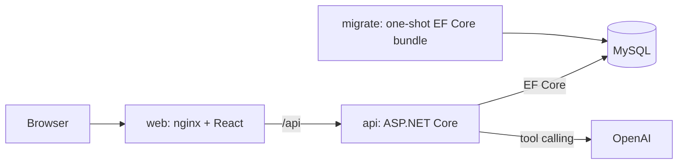

# InnoPaint

Paint store with an AI palette assistant.

**Stack:** ASP.NET Core (.NET 10) · EF Core + MySQL · React 19 + TypeScript · Docker Compose · Azure Container Apps · Terraform · GitHub Actions

## Features

- **Catalog:** search, filters, sorting and stable paging.
- **Baskets:** stock limits are enforced even when requests arrive at the same time. The API returns 409 if a quantity exceeds stock.
- **AI palette assistant:** built on Microsoft Agent Framework and Microsoft.Extensions.AI with OpenAI. The model can only call three catalog tools. The server accepts only paints that were found by a search in the current turn and are in stock (2–4 per palette).
- **Validation and errors:** FluentValidation for input, Problem Details for every error.

## Quickstart

Requires Docker.

```sh
cd Program
cp .env.example .env    # set OPENAI_API_KEY (required)
docker compose up --build
```

Open http://localhost:8080. The catalog starts empty. Add paints with the requests in `Program/src/Innowise.Api/Innowise.Api.http`.

## Architecture



```text
Program/
  src/        Domain, Application, Infrastructure and Api projects (Clean Architecture), plus BuildingBlocks
  frontend/   React SPA, served by nginx
  tests/      HTTP smoke checks (store_smoke.py)
infra/        Terraform for Azure
.github/      deploy workflow
```

**Consistency:** each stock check and the write that follows run in one database transaction. The paint row is locked with `SELECT ... FOR UPDATE`, so two concurrent requests can't break the stock limit. The lock lives in MySQL, so this still holds with several API instances.

## Deployment

Terraform (`infra/`) provisions Azure Container Apps, Container Registry and Azure Database for MySQL. On every push to `main`, GitHub Actions builds the images, runs the migrations and deploys. It logs in to Azure with OIDC, so no cloud credentials are stored.

## Known limitations

- **Single API replica:** assistant conversations are kept in memory.
- **No checkout:** baskets do not reserve stock.
- **No authentication:** catalog writes are not protected.

## More

- [Backend notes](Program/src/README.md): endpoints, query parameters, business rules, and running without Docker.
- [Frontend notes](Program/frontend/README.md).
